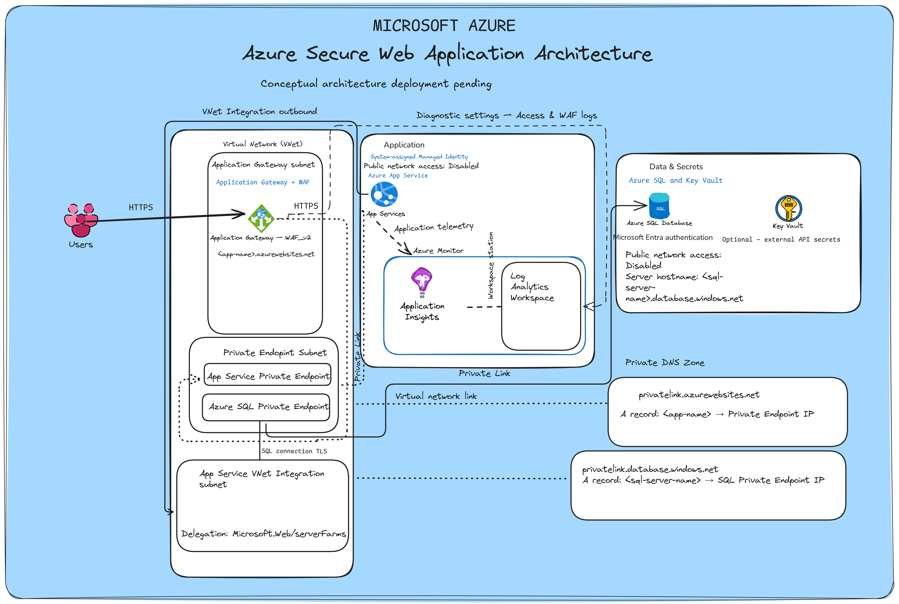

# Azure Secure Web Application Architecture

## Project Overview

This project presents a conceptual secure web application architecture designed using Microsoft Azure services and Excalidraw.

**Status:** Architecture Design Completed | Deployment Pending

## Architecture Diagram

## Azure Services

- **Application Gateway + WAF v2:** Web traffic routing and application protection.
- **Azure App Service:** Managed web application hosting.
- **Azure Virtual Network:** Network segmentation and private connectivity.
- **Azure Private Link:** Private connectivity to application and data services.
- **Azure SQL Database:** Managed relational database.
- **Azure Key Vault:** Secure management of secrets.
- **Microsoft Entra ID:** Identity and authentication.
- **Azure Monitor & Application Insights:** Application monitoring and telemetry.
- **Log Analytics Workspace:** Centralized logging and analysis.

## Security Architecture

The conceptual design includes:

- HTTPS traffic through Application Gateway and WAF.
- Private Endpoints for application and database services.
- Restricted public network access.
- Managed identity for supported service authentication.
- Private DNS resolution.

## Learning Objectives

- Understand secure Azure architecture design.
- Explore network isolation and Private Link.
- Learn cloud security and identity fundamentals.
- Practice technical architecture documentation.

## Next Steps

- Implement the infrastructure using Terraform.
- Validate Infrastructure as Code.
- Deploy and test the architecture in Microsoft Azure.

---

**Note:** This is a self-directed architecture design project. No infrastructure has been deployed in Azure yet.
